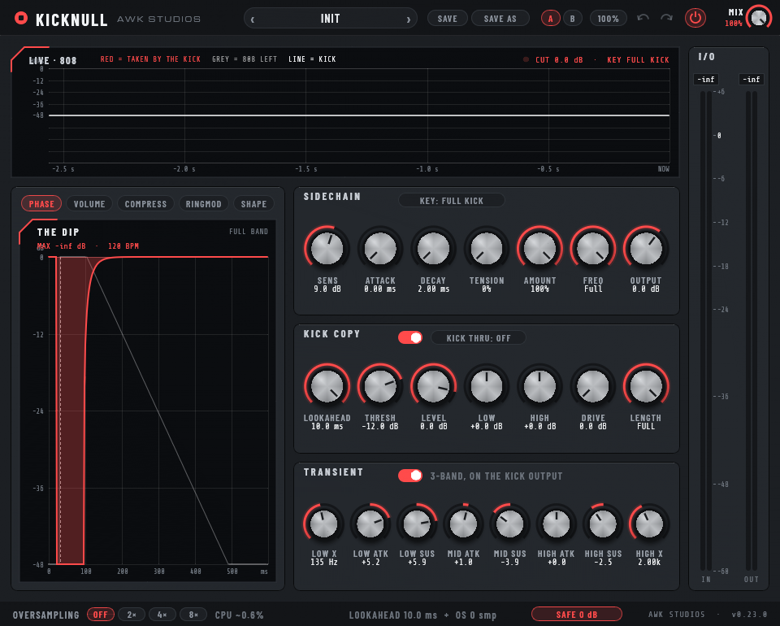

# KICKNULL

**Zero-latency kick-to-808 sidechain: the kick nulls the 808 instead of just turning it down.**



KICKNULL goes on your 808 with the kick routed to its sidechain input. In PHASE mode it mixes a polarity-flipped copy of the 808 back in, at a level that follows the kick, so the low end cancels exactly where the kick hits and swells back as the kick dies away. It also has VOLUME, COMPRESS, RINGMOD and SHAPE modes, a KICK COPY stage and a transient shaper.

## Features

- **Five duck modes:** PHASE (cancellation), VOLUME, COMPRESS, RINGMOD and SHAPE (8 LFO shapes, per kick or beat-synced).
- **FOLLOW** (envelope) or **CURVE** (a fixed dip shape fired by each kick, with its length as a note value).
- **FREQ:** cancel only below a frequency, or the whole 808.
- **KICK COPY:** adds the sidechain kick through a brickwall limiter, with tone, drive and length.
- **TRANSIENT shaper** with three bands, and a GATE stage for the kick click.
- LIVE scope and THE DIP display, LOOKAHEAD and SAFE.
- 37 factory presets.

## Install

Windows 64-bit, VST3. Built and tested in FL Studio.

1. Download `KickNull-v0.22.1-win64.zip` from [Releases](../../releases/latest).
2. Copy `KickNull.vst3` into `C:\Program Files\Common Files\VST3\`.
3. Copy the files in `presets` into `Documents\Awknode\Presets\KickNull\` (create the folder if it doesn't exist).
4. Rescan plugins in your DAW.

## Using it

Every awk studios plugin has the same top strip: preset browser, A/B, undo/redo, power (bypass) and a global MIX. Knobs drag up and down (hold Ctrl or Shift for fine control), scroll to nudge, and double-click to reset. **SAFE** in the footer is an output limiter that keeps the plugin from going over 0 dBFS; it's on by default.

The full control reference is in the **[manual](docs/MANUAL.md)**.

## Build from source

You'll need Docker. Clone this repo next to the [nice-plug-awk](https://github.com/awknode/nice-plug-awk) framework fork, then run the build script:

```sh
git clone https://github.com/awknode/kicknull
git clone -b awk-studios https://github.com/awknode/nice-plug-awk
cd kicknull && ./build.sh
```

The plugin lands in `target/bundled/KickNull.vst3`.

## License

GPL-3.0. See [LICENSE](LICENSE). Built with [nice-plug](https://codeberg.org/RustAudio/nice-plug).

---

More awk studios plugins: [VISE](https://github.com/awknode/vise) · [SALVE](https://github.com/awknode/salve) · [HOIST](https://github.com/awknode/hoist) · [KILN](https://github.com/awknode/kiln) · [PATINA](https://github.com/awknode/patina) · [CHOPSHOP](https://github.com/awknode/chopshop) · [THROWBACK](https://github.com/awknode/throwback) · [THROW FX](https://github.com/awknode/throw-fx) · [ALLEYVERB](https://github.com/awknode/alleyverb) · [WAVETAG](https://github.com/awknode/wavetag) · [dBCOMP](https://github.com/awknode/dbcomp) · [dBVOX](https://github.com/awknode/dbvox)
